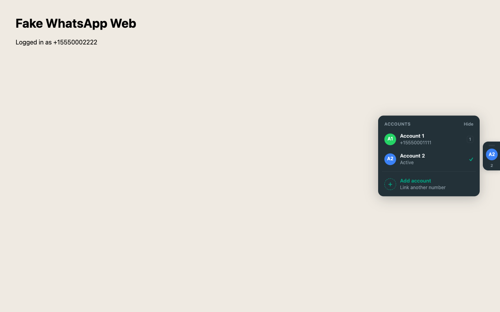
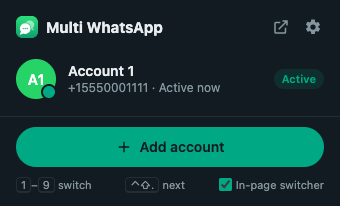
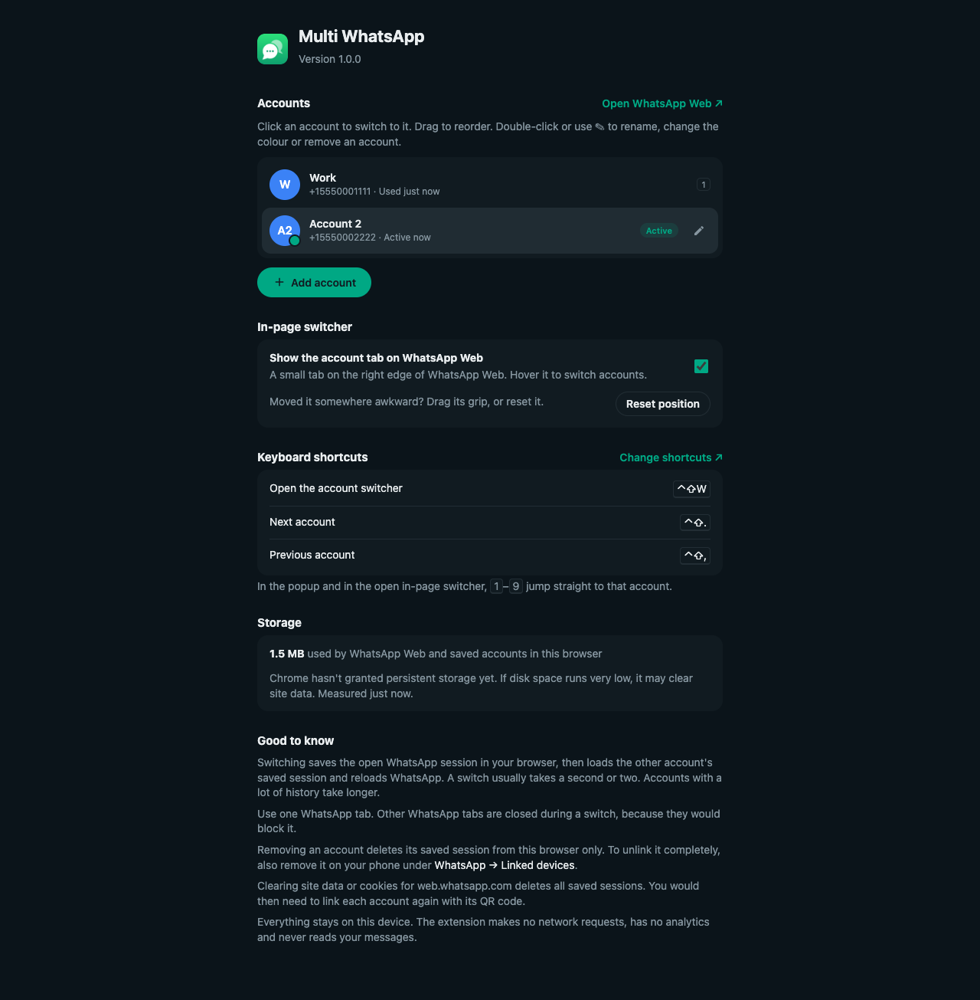

# Multi WhatsApp

A Chrome extension that keeps several WhatsApp Web accounts in one browser profile and switches between them in a click. You don't need a second Chrome profile, and you don't need to log out and scan a QR code each time.



## Install in Chrome

1. Build it (see [Development](#development)), or unzip a release from `release/`.
2. Open `chrome://extensions` in Chrome.
3. Turn on **Developer mode** in the upper-right corner.
4. Click **Load unpacked** and select the `dist/` folder (the one containing `manifest.json`).
5. Pin **Multi WhatsApp** from Chrome's puzzle-piece Extensions menu.
6. Open (or reload) [web.whatsapp.com](https://web.whatsapp.com). If you're already logged in, that session becomes **Account 1**.

Keep the folder in place while the extension is installed. After rebuilding, click the extension's **Reload** button in `chrome://extensions`, then reload the WhatsApp tab.

## Use

**Add an account:** Open the toolbar popup and click **Add account**. Your current account is saved and WhatsApp reloads with a fresh QR code. Scan it from the other phone under *WhatsApp → Linked devices → Link a device*.

**Switch accounts:** Use any of these.

| Where | How |
|---|---|
| Toolbar popup | Click an account, or press <kbd>1</kbd>–<kbd>9</kbd> |
| WhatsApp Web | Hover the small tab on the right edge and click an account (or press <kbd>1</kbd>–<kbd>9</kbd> while it's open) |
| Anywhere in Chrome | <kbd>Ctrl</kbd>+<kbd>Shift</kbd>+<kbd>.</kbd> / <kbd>,</kbd> on Mac, <kbd>Alt</kbd>+<kbd>Shift</kbd>+<kbd>.</kbd> / <kbd>,</kbd> elsewhere, for next/previous account. <kbd>Ctrl</kbd>/<kbd>Alt</kbd>+<kbd>Shift</kbd>+<kbd>W</kbd> opens the popup. You can change these at `chrome://extensions/shortcuts` |

A switch takes well under a second for a typical session. Accounts with a lot of history take a little longer. The toolbar badge shows the active account's initials in its colour.

**Organise accounts:** Double-click an account, or hover it and click ✎, to rename it, change its colour or remove it. Drag accounts to reorder them; the order sets the <kbd>1</kbd>–<kbd>9</kbd> keys. The phone number of each linked account is detected automatically.

**Settings:** The ⚙ button in the popup opens the settings page. There you can turn the in-page switcher on or off, reset its position, see your shortcuts and see how much storage your saved accounts use.

| Popup | Settings |
|---|---|
|  |  |

## How it works

WhatsApp Web keeps the whole session (encryption keys, chats, settings) in IndexedDB and `localStorage` on `https://web.whatsapp.com`. A switch works like this:

1. The extension sends the WhatsApp tab to `https://web.whatsapp.com/?mwa_op=…`. Its content script runs at `document_start` and calls `window.stop()`, so WhatsApp's own code never starts and nothing holds the databases open.
2. It copies every live database and `localStorage` into a vault in the same origin: IndexedDB databases named `mwa:<account-id>:<db>`, plus a `mwa-vault` index. Schemas, versions, indexes, key paths and auto-increment stores are reproduced exactly.
3. It clears the live storage, copies the target account's vault back in, and reloads WhatsApp.

Everything stays inside WhatsApp's own origin. That isn't optional: WhatsApp holds *non-extractable* `CryptoKey`s that can be structured-cloned between databases of the same origin but can never be exported anywhere else.

**Safety:**
- Live storage is cleared only after it has been saved in full.
- Before clearing, the extension records that the live session belongs to no account. If a switch is interrupted (crash, closed tab, quota error), a retry can never save a half-cleared session over a good snapshot.
- On failure, the switch page shows the error with **Retry** and **Back to WhatsApp**.
- If something still holds a database open (WhatsApp's service worker, in practice), the extension unregisters that worker so the delete can finish. WhatsApp re-registers it on the next load.
- The extension asks Chrome to make the origin's storage persistent, because it now holds every account and not just a cache.

## Permissions and privacy

| Permission | Why |
|---|---|
| `storage` | Keeps the account list (names, colours, detected phone numbers) and your settings on this device |
| `browsingData` | Stops WhatsApp's service worker if it blocks a switch. It's used only for `web.whatsapp.com` and only for service workers |
| Host access to `https://web.whatsapp.com/*` | Runs the in-page switcher and performs the session swap |

The extension never reads, sends or indexes your messages. It reads one `localStorage` value to show the account's phone number. It makes no network requests and has no analytics, remote code, runtime dependencies or update service. Account sessions never leave WhatsApp's origin in your browser profile. See [PRIVACY.md](PRIVACY.md).

## Limits

- **One WhatsApp tab.** Extra WhatsApp tabs are closed during a switch, because they would block it. WhatsApp only lets one tab be active anyway.
- **Removing an account** deletes its saved session from this browser. To unlink it completely, also remove the device on your phone under *Linked devices*.
- **Clearing site data** for web.whatsapp.com (or "cookies and site data" for all time) deletes every saved account. You'd then need to link each account again with its QR code. Your chats are still on your phones.
- **Incognito is disabled.** All accounts share one vault, so a parallel incognito copy would conflict with it.
- **Disk space:** each saved account takes about as much as one WhatsApp Web session. The settings page shows the total.
- **Only one account runs at a time.** Inactive accounts don't receive messages until you switch to them, the same as a closed WhatsApp Web tab. Your phone still gets everything.
- The extension depends on how WhatsApp Web stores its session. It treats that storage generically and copies whatever databases exist, but a major WhatsApp change could still break it.

## Development

Requires [Bun](https://bun.sh) ≥ 1.3. Dependencies are pinned to exact versions (`bun.lock`), and `bunfig.toml` rejects any package version published less than **7 days** ago (`minimumReleaseAge`).

```sh
bun install
bun run build       # → dist/ (minified)
bun run dev         # watch mode, unminified + inline sourcemaps
bun run typecheck   # tsc --noEmit (strict)
bun test tests/unit # unit tests
bun run test:e2e    # real extension in Chrome for Testing against a fake web.whatsapp.com
bun run check       # all of the above
bun run zip         # → release/multi-whatsapp-<version>.zip
```

The end-to-end suite needs Chrome for Testing, because branded Chrome can no longer load unpacked extensions from the command line. It finds Playwright's copy automatically, or you can set `CHROME_PATH`. It maps `web.whatsapp.com` to a local HTTPS server and serves a fake WhatsApp with these traits:

- a strict CSP
- a non-extractable `CryptoKey`
- `Blob` values
- out-of-line, compound, auto-increment and multi-entry keys and indexes
- a 3,000-record database (copied in several chunks)
- a service worker that holds the database open and ignores `versionchange`

Run it with `HEADFUL=1` to watch. See [VERIFICATION.md](VERIFICATION.md) for the latest results.

### Layout

```
src/
  background/index.ts   service worker: account state, switch dispatch, badge, shortcuts
  content/index.ts      entry: switch page (?mwa_op=…) or in-page switcher
  content/vault.ts      IndexedDB + localStorage snapshot / restore
  content/op-page.ts    the "Switching…" page that runs a vault operation
  content/dock.ts       in-page account switcher (shadow DOM)
  ui/account-list.ts    account list shared by popup + settings (edit, reorder, keys)
  ui/base.css           shared design tokens + list styles
  popup/  options/      toolbar popup and settings page
  shared/               types, helpers, CSP-safe DOM helpers
scripts/
  build.ts              esbuild bundling, manifest generation, icons
  icons.ts              dependency-free PNG icon renderer
  zip.ts                release packaging
tests/
  unit/                 bun test
  e2e/                  puppeteer-core + fake WhatsApp fixture
```
